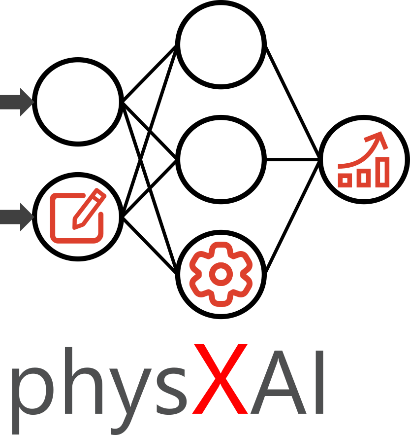

[](https://opensource.org/licenses/BSD-3-Clause)
[](https://rwth-ebc.github.io/physXAI/main/docs/index.html)
[](https://rwth-ebc.github.io/physXAI/main/coverage/index.html)
[](https://rwth-ebc.github.io/physXAI/main/pylint/pylint.html)
[](https://doi.org/10.1016/j.buildenv.2025.113640)


<div>

</div>

# physXAI

## About The Project
The physXAI Toolbox is designed for creating physics-guided machine learning models, also known as physics-informed or physics-constrained models. <br /> 
These models are specifically intended for application in Model Predictive Control (MPC) of Building Energy Systems (BES). <br />
The toolbox aims to integrate physical knowledge into machine learning models to improve their accuracy, robustness, and interpretability for energy system optimization. <br />
<br />
If you have any questions regarding physXAI, feel free to contact us at ebc-tools@eonerc.rwth-aachen.de  

## Installation
1. Create a virtual environment with Python >= 3.11 and activate it:
	```
	python -m venv physXAI
	```
	- **On Windows:**
	  ```
	  physXAI\Scripts\activate.bat
	  ```
	- **On Unix/Linux/macOS:**
	  ```
	  source physXAI/bin/activate
	  ```
2. Clone physXAI git repo:
	```
	git clone https://github.com/RWTH-EBC/physXAI.git
	```
3. Switch in project directory:
	```
	cd <path_to_repository>
	```
4. A) To install physXAI as a user:
	```
	pip install .
	```
 
    B) To install physXAI as a developer (tests, linting, AgentLib-MPC contract tests):
	```
	pip install -e .[dev,agentlib]
	pre-commit install
	```

## Getting Started
The [documentation](https://rwth-ebc.github.io/physXAI/main/docs/index.html) contains a user guide, the API reference and a
[migration guide from physXAI 0.x to 1.0](https://rwth-ebc.github.io/physXAI/main/docs/migration.html). <br />
The [`examples`](https://github.com/RWTH-EBC/physXAI/tree/main/examples) directory is a tutorial in 13 numbered,
commented scripts, from a first model (`01_first_model.py`) over expressions, recurrent and physics-informed models
and the comparison of models to the export for AgentLib-MPC (`13_agentlib_mpc.py`). They serve as a starting point
for new projects:

```bash
python examples/01_first_model.py
```

```python
from physXAI import expr as px
from physXAI.io import Run
from physXAI.models import LinearRegressionModel
from physXAI.preprocessing.preprocessing import PreprocessingSingleStep

run = Run('results', 'TAir', overwrite=True)
prep = PreprocessingSingleStep(inputs=['weaSta_reaWeaTDryBul_y', 'oveHeaPumY_u', 'reaTZon_y'],
                               output=px.Change('reaTZon_y'), time_index_col='time', eval_horizon='12h')
td = prep.pipeline('data/bestest_hydronic_heat_pump/pid_data.csv')
model = LinearRegressionModel()
model.pipeline(td)                    # train, evaluate (single step and recursively over 12 h)
run.save('model', prep, model, td)    # configs, metrics, model and report (html)
```

## Current Model Types
The physXAI currently focuses on physics-guided neural networks build with Keras and Tensorflow.
Models in this repository are categorized into two main types:

- Single-Step Models: Predicting one step ahead. Applied recursively in the MPC, evaluated and optionally
  trained on the error over the prediction horizon.
	- Linear Regression (scikit-learn)
	- Classical ANN
	- Radial Basis Function Network (RBF): RBF Models extrapolate to 0. Useful for residual models.
	- Residual Model: hybrid model combining a Linear Regression model with an RBF, that models the residuals of the linear regression.
	- Constrained Monotonic Neural Network (CMNN): Allows enforcing monotonicity, convex and concave constraints on input features.
	- Physics-Informed Neural Network (PINN): Allows to add physics-informed loss functions
	- Modular ANN: physically motivated expressions and trainable blocks (linear, MLP, CMNN, RBF, ...) in one model
	- Constrained Regression: linear regression on expressions with monotonicity and convexity constraints
- Multi-Step Models: Predicting a trajectory.
	- Recurrent Neural Network: SimpleRNN, GRU and LSTM, warmed up on the measured past.

Trained models can be used in [AgentLib-MPC](https://github.com/RWTH-EBC/AgentLib-MPC).
Several models, each trained with several seeds, can be compared with `physXAI.evaluation.comparison`.

## Project Structure
The project is organized into the following directories:

- `examples`: Tutorial scripts showing the features of physXAI, the starting point for users (see `examples/README.md`).
	- The examples use data from the BOPTEST 'Bestest Hydronic Heat Pump' test case: https://ibpsa.github.io/project1-boptest/testcases/ibpsa/testcases_ibpsa_bestest_hydronic_heat_pump/
- `data`: Storage for input data, typically in `.csv` format. Datasets required for training and evaluating models should be placed here.
- `results`: Default directory of the runs (`Run`): trained models, configs, metrics and reports.
- `physXAI`: Contains the core logic and main functionalities of the physXAI Toolbox.
	- `expr`: Expression language for physically motivated terms and trainable blocks (NumPy, Keras and CasADi).
	- `preprocessing`: Loading, derived columns, leakage free split and training data.
	- `models`: Model definitions (linear regression, ANNs, modular models, RNNs).
	- `training`: Training on the error over the prediction horizon.
	- `evaluation`: Metrics, errors over the horizon and the comparison of models.
	- `feature_selection`: (Automatic) feature selection.
	- `plotting`: Reports of trained models.
	- `io`: Run directories and the export for AgentLib-MPC.
	- `agentlib_mpc_plugin`: Example training scripts for AgentLib-MPC.
- `docs`: Contains documentation for the project.
- `build`: Contains saved test reports.
- `tests`: Tests of physXAI (pytest), the contract tests with AgentLib-MPC and the smoke run of the examples.

## How to contribute to the development

You are invited to contribute to the development of this toolbox.
Issues can be reported using this site's Issues section.
Furthermore, you are welcome to contribute via Pull Requests.

## Referencing physXAI

To cite physXAI, please use the following paper:

> Henkel, Patrick and Roß, Simon and Rätz, Martin and Müller, Dirk, Monotonic physics-constrained neural networks for model predictive control of building energy systems. Building and Environment, 2025, 285, 113640. https://doi.org/10.1016/j.buildenv.2025.113640

## Copyright and license
This tool is released by RWTH Aachen University, E.ON Energy Research Center, Institute for Energy Efficient Buildings and Indoor Climate <br />
and is licensed under the BSD 3 Clause License - see the [LICENSE](https://github.com/RWTH-EBC/physXAI/blob/main/LICENSE) file for details.

## Acknowledgments

We gratefully acknowledge the financial support by Federal Ministry for Economic Affairs and Climate Action (BMWK), promotional reference 03EN6022B.


## Contact
Patrick Henkel <br />
ebc-tools@eonerc.rwth-aachen.de <br />
https://www.ebc.eonerc.rwth-aachen.de/cms/~dmzz/E-ON-ERC-EBC/